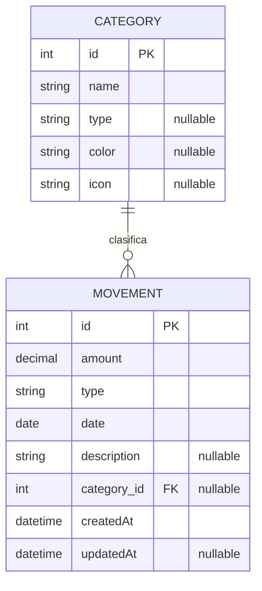

# Gestor de Gastos — Modelo de Datos

Este documento define las entidades del MVP, sus atributos y relaciones.
Es la referencia de diseño previa a la implementación (entidades Doctrine,
migraciones y formularios).

## Resumen

El dominio gira en torno a los **movimientos** de dinero (gastos e ingresos),
que opcionalmente se clasifican con una **categoría**.

- Un movimiento puede tener **cero o una** categoría.
- Una categoría puede estar asociada a **muchos** movimientos.

## Entidades

### Movement (Movimiento)

Representa una entrada o salida de dinero. Es el núcleo de la aplicación.

| Campo         | Tipo                 | Nulo | Descripción                                    |
|---------------|----------------------|------|------------------------------------------------|
| `id`          | int (PK, auto)       | No   | Identificador único.                           |
| `amount`      | decimal(10,2)        | No   | Importe del movimiento. Siempre positivo.      |
| `type`        | enum `MovementType`  | No   | `EXPENSE` (gasto) o `INCOME` (ingreso).        |
| `date`        | date                 | No   | Fecha en la que ocurre el movimiento.          |
| `description` | string(255)          | Sí   | Texto corto que describe el movimiento.        |
| `category`    | relación → Category  | Sí   | Categoría asociada. **Opcional** en el MVP.    |
| `createdAt`   | datetime_immutable   | No   | Fecha de alta del registro.                    |
| `updatedAt`   | datetime_immutable   | Sí   | Última modificación del registro.              |

Notas de diseño:

- El importe se guarda como `decimal` (no `float`) para evitar errores de
  precisión con dinero.
- `amount` se almacena siempre positivo; el signo lo determina `type`.
- `type` se modela como un **enum de PHP 8.4** (`App\Enum\MovementType`).

### Category (Categoría)

Agrupa movimientos para poder analizarlos (ej. comida, transporte, ocio).

| Campo       | Tipo                   | Nulo | Descripción                                       |
|-------------|------------------------|------|---------------------------------------------------|
| `id`        | int (PK, auto)         | No   | Identificador único.                              |
| `name`      | string(100)            | No   | Nombre de la categoría. Único.                    |
| `type`      | enum `MovementType`    | Sí   | Si la categoría es de gasto, ingreso o ambas.     |
| `color`     | string(7)              | Sí   | Color hexadecimal para la UI (ej. `#FF8800`).     |
| `icon`      | string(50)             | Sí   | Identificador de ícono para la UI.                |
| `movements` | relación ← Movement[]  | —    | Movimientos asociados (lado inverso).             |

Notas de diseño:

- `type` en la categoría es opcional: si es `null`, la categoría sirve para
  cualquier tipo de movimiento.
- `name` debería ser único para evitar duplicados.

## Enum: MovementType

Enum de PHP respaldado por string, reutilizado por `Movement` y `Category`.

| Caso      | Valor       | Significado |
|-----------|-------------|-------------|
| `EXPENSE` | `"expense"` | Gasto       |
| `INCOME`  | `"income"`  | Ingreso     |

## Relaciones

```
Category (1) ──────< (0..N) Movement
   │                            │
   │  una categoría tiene       │  un movimiento pertenece
   │  muchos movimientos        │  a 0 o 1 categoría (opcional)
```

- **Category → Movement**: OneToMany.
- **Movement → Category**: ManyToOne, **nullable** (un movimiento puede no
  tener categoría).
- Al borrar una categoría, sus movimientos **no** se borran: el campo
  `category` del movimiento queda en `null` (`ON DELETE SET NULL`).

## Diagrama entidad-relación



## Reglas de negocio

1. `amount` siempre mayor que 0.
2. `type` es obligatorio en todo movimiento.
3. La categoría es opcional; un movimiento sin categoría se considera
   "Sin clasificar".
4. Borrar una categoría no elimina sus movimientos (quedan sin categoría).
5. Los nombres de categoría son únicos.

## Fuera de alcance (futuro)

- Entidad `User` para soporte multiusuario (cada usuario con sus movimientos
  y categorías). Al incorporarla, `Movement` y `Category` tendrían una
  relación ManyToOne hacia `User`.
- Presupuestos (`Budget`) por categoría y período.
- Movimientos recurrentes.
